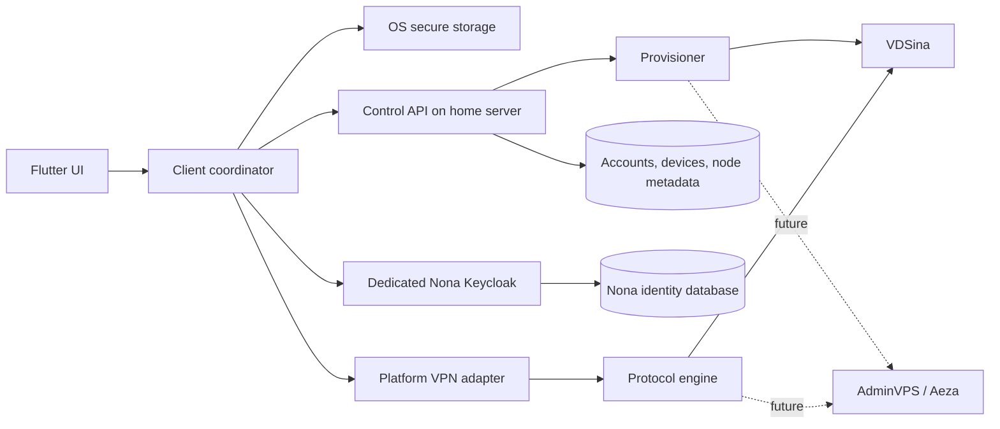

# Архитектура и ограничения

Проверено по официальной документации 9 ноября 2026 года. Источники перечислены в конце.

## Схема

Control API управляет учётными записями, устройствами, узлами, политиками и версиями конфигураций. Data plane идёт напрямую от клиента к выбранному VPN-узлу; домашний сервер не должен становиться транзитной точкой пользовательского трафика. Домашний сервер является точкой обновлений: последняя действующая конфигурация остаётся на устройстве при кратком отключении API.

Локальный служебный адрес `nona.server.basketref.ru` разрешается MikroTik в `192.168.3.24` и использует внутренний сертификат Caddy. Удалённый доступ к таким служебным адресам сейчас идёт через WireGuard к MikroTik. Для клиентского API нужна точка входа с доступом из мобильной сети и доверенным HTTPS-сертификатом: на Android одновременно активна только одна VPN-служба, поэтому приложение Ноны не может рассчитывать на работающий WireGuard для входа и обновления конфигурации. Подготовлен [план публичного доступа](publication.md), но локальный сайт пока не является готовым адресом для клиентской сборки.

Каждый пользователь получает отдельные данные доступа для VLESS+REALITY и Hysteria2. Серверный provisioner хранит соответствие `user → device → credential → node`, создаёт и отзывает учётные данные на VDSina, а позже применяет тот же интерфейс к AdminVPS и Aeza. У каждого узла есть стабильный ID, регион, список протоколов, состояние и версия конфигурации. Адрес существующего VDSina-узла, его порты и секреты вводятся отдельно оператором и не зашиваются в приложение или документацию.

Для VLESS+REALITY выбрано Xray-core, как в Happ и v2rayNG. Hysteria2 на первом этапе использует официальный Hysteria 2 core отдельно, как один из вариантов v2rayN. Android-сборка уже включает libXray и нативную VPN-службу, но не содержит действующих конфигураций. Hysteria 2 и ядра остальных платформ ещё не встроены. Обоснование и лицензии — в `engine-choice.md`.

## Безопасность аккаунтов и конфигураций

1. Аккаунты по приглашению ведёт отдельный Keycloak Ноны. Публичная регистрация выключена. Приложение входит через системный браузер по Authorization Code + PKCE, API проверяет OIDC access token. Пароль и его хеш не хранятся в базе API.
2. После входа регистрируется устройство. Токены хранятся средствами защищённого хранилища ОС; refresh token отзывается при выходе. Настройка SMTP и подтверждение почты для операторского аккаунта ещё требуются.
3. Control API отдаёт заранее установленную конфигурацию только активному устройству владельца; снаружи перед ним требуется HTTPS reverse proxy. Ответ имеет `Cache-Control: no-store`, версию, срок действия и подпись. Клиент проверяет подпись до применения и атомарно заменяет сохранённый набор; минимум принятой версии защищает от отката. Автоматическое создание credentials на VPN-узле и их отзыв пока отсутствуют.
4. В клиентском каркасе проверенный пакет сохраняется через `flutter_secure_storage`; он использует платформенные механизмы защищённого хранения. Перед выпуском нужно проверить настройки Android Keystore, iOS/macOS Keychain и Windows на реальных устройствах и уточнить политику резервного копирования. Не писать секреты в логи, аналитику, crash reports, буфер обмена и обычные preferences. Для Apple Packet Tunnel понадобится явно настроенная группа доступа Keychain между приложением и extension; сейчас она не настроена. При обрыве записи после обновления минимальной версии клиент отказывается загружать старый пакет и требует повторной синхронизации.
5. Подписанный пакет защищает от подмены, но не делает секреты невидимыми владельцу или ОС. На взломанном устройстве, при доступе администратора, дампе памяти или компрометации приложения абсолютной защиты нет. Пользователь всегда может извлечь данные на своём устройстве. Формулировка «доступ только у программы» не является гарантией.
6. Ключ подписи, серверные credential и доступ к VDS хранятся на сервере отдельно от репозитория. Провижининг — через ограниченный канал с аудитом, идемпотентными операциями и откатом при частичном отказе. Не генерировать отдельные ссылки вручную после настройки системы.

## Маршрутизация

Приоритет правил: локальные/частные сети → явные исключения пользователя → российские домены и адресные блоки → остальное через VPN. Правила по доменам требуют контролируемого DNS и синхронизации DNS-ответа с маршрутом. CDN, общие IP, DoH внутри приложений, IPv6 и изменение адресов не позволяют гарантировать, что каждый «российский сайт» всегда пойдёт напрямую. Для отдельных приложений возможны собственные соединения и DNS; результаты надо проверять на реальных устройствах.

Android `VpnService` даёт системный запрос разрешения и списки разрешённых либо исключённых приложений; список задаётся до установления VPN. Соединение к VPN-серверу должно быть выведено из туннеля через `protect()`. При включённом системном lockdown режим прямых исключений может конфликтовать с политикой «всё через VPN» — приложение должно явно объяснять это пользователю.

На iOS и macOS использовать `NetworkExtension`/`NEPacketTunnelProvider` с соответствующим entitlement. Apple разрешает включённые и исключённые IP-маршруты. Произвольный per-app VPN на обычном iPhone недоступен: правила для приложений требуют управляемого устройства/MDM. Apple отдельно предупреждает, что packet tunnel не предназначен для захвата всего трафика с последующей отправкой части через локальный proxy вне туннеля. Поэтому MVP iOS предусматривает системные маршруты по IP и DNS-политику с честно указанными ограничениями; точное исключение произвольных приложений в iOS не входит в обещание.

На Windows нужен системный VPN adapter/plug-in, а не только Flutter UI. Варианты — Windows VPN plug-in или поддерживаемый TUN-адаптер с отдельным привилегированным сервисом; выбор после прототипа и проверки установки, обновлений, подписи и удаления. Общие правила по доменам/адресам реализует ядро; per-app исключения в Windows отложены до проверки их надёжности.

## Авто-переключение

Клиент проверяет доступность каждого разрешённого узла и протокола без передачи секретов в телеметрию. Переключение происходит при потере связи или устойчивом ухудшении; гистерезис не даёт менять узел из-за небольшого колебания задержки. При отсутствии здоровых узлов UI показывает отказ. Политика при разрыве (разрешать прямой выход или блокировать) задаётся пользователем и возможностями ОС; молчаливый прямой выход недопустим, если пользователь выбрал защиту от утечек. Текущий `node_selection.dart` реализует только выбор по результатам проверок, не сами проверки и не подключение.

## Видимость VPN

Нельзя скрыть от ОС VPN-интерфейс, системный запрос разрешения, статус/значок подключения или существование установленного приложения. Другие приложения могут видеть часть признаков VPN через разрешённые API или сетевое поведение; гарантировать невидимость нельзя. Нона не маскирует разрешения и не обходит механизмы безопасности ОС. Иконка и название продукта могут быть нейтральными, но описание функции должно быть правдивым.

## Источники

- [Android VPN guide](https://developer.android.com/develop/connectivity/vpn) и [VpnService API](https://developer.android.com/reference/android/net/VpnService)
- [Apple: Routing your VPN network traffic](https://developer.apple.com/documentation/networkextension/routing-your-vpn-network-traffic), [Network Extension setup](https://developer.apple.com/documentation/xcode/configuring-network-extensions/), [TN3120](https://developer.apple.com/documentation/technotes/tn3120-expected-use-cases-for-network-extension-packet-tunnel-providers), [TN3134](https://developer.apple.com/documentation/technotes/tn3134-network-extension-provider-deployment)
- [Microsoft: VPN connection types](https://learn.microsoft.com/en-us/windows/security/operating-system-security/network-security/vpn/vpn-connection-type) и [IVpnPlugIn](https://learn.microsoft.com/en-us/uwp/api/windows.networking.vpn.ivpnplugin)
- [Xray-core](https://github.com/XTLS/Xray-core), [Hysteria 2](https://github.com/HyNetworks/hysteria), [v2rayNG](https://github.com/2dust/v2rayNG), [v2rayN supported cores](https://github.com/2dust/v2rayN/wiki/List-of-supported-cores), [Happ](https://www.happ.su/main)
- [Apple Keychain](https://developer.apple.com/documentation/security/using-the-keychain-to-manage-user-secrets), [Windows DPAPI](https://learn.microsoft.com/en-us/windows/win32/api/dpapi/nf-dpapi-cryptprotectdata)
